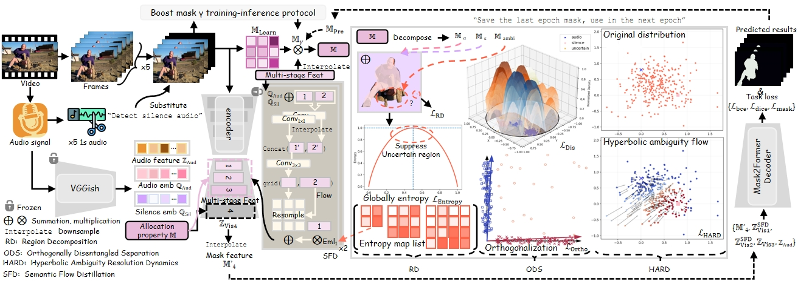

<div align="center">

# AR2SA

### Geometric Polarization of Ambiguous Regions towards Silent and Audio States for Audio-Visual Segmentation

**Audio-Visual Segmentation · Geometric Polarization · Audio-Guided Mask Prediction**

[Overview](#overview) · [Architecture](#architecture) · [Getting Started](#getting-started) · [Training](#training) · [Evaluation](#evaluation) · [Analysis](#analysis-and-visualization)

</div>

---

## Overview

Audio-visual segmentation aims to identify the image regions associated with sounds in a video. Visually salient objects can remain silent, making ambiguous regions difficult to assign to sounding foreground or silent background.

**AR2SA** explores geometric polarization of these ambiguous regions towards silent and audio states. This repository contains an audio-guided segmentation model, a customized Mask2Former implementation, training and evaluation entry points, and utilities for inspecting geometric behavior.

The current implementation combines:

- **Visual features:** a Mask2Former model with a Swin backbone.
- **Audio guidance:** 128-dimensional VGGish embeddings projected into the segmentation model.
- **Region guidance:** foreground masks from `opticalNObg` (utilize optical flow (Opticl-Perceiver-IO DeepMind) and background removal (BRIA)) and optional previously predicted masks.
- **Selective fine-tuning:** adapters, query embeddings, the class predictor, and audio projection layers.
- **Evaluation and analysis:** mIoU, F-score, predicted masks, and geometry comparison plots.

> **Repository status:** this checkout contains research code and analysis assets. Data, pretrained weights, and a pinned environment are not bundled. The setup notes below describe the current files; end-to-end reproduction still requires resolving the implementation gaps listed under [Current implementation notes](#current-implementation-notes).

## Architecture

<div align="center">
  
  <p><em>Overview of the AR2SA framework.</em></p>
</div>

The model wrapper in [`avs_model.py`](avs_model.py) projects audio embeddings through a `128 → 512 → 256` network and supplies them to the customized Mask2Former alongside video frames and region masks. Binary segmentation outputs are resized to the target image dimensions for evaluation.

## Repository Structure

```text
AR2SA-main/
├── README.md                     # Project overview and usage notes
├── avs_model.py                   # Audio-guided segmentation model
├── config.py                      # Command-line arguments and defaults
├── dataset.py                     # AVSBench loading and preprocessing
├── train.py                       # Training entry point
├── test.py                        # Checkpoint evaluation entry point
├── transformer/                   # Customized Transformers source
├── scripts/
│   ├── evaluation.py              # Metrics and prediction export
│   ├── save_mask.py               # Mask image saving
│   ├── precompute_audio_vggish_cache.py
│   ├── sfd_memory.py              # SFD mask memory utilities
│   ├── compare_three_geometry.py  # Geometry comparison analysis
│   └── plot_*.py                  # Plotting utilities
├── utils/                         # Losses, metrics, and helper functions
├── png/architecture.png           # Framework illustration
└── VIS_PTH_COMPARE_THREE_TFS/
    └── COMPARE/                   # Existing geometry plots and CSV files
```

## Getting Started

### 1. Environment

Run commands from the repository root:

```bash
cd AR2SA-main
```

The source imports the following dependencies. This is a source-derived dependency list, not a validated or version-pinned installation recipe.

| Component | Dependencies / requirements |
| :--- | :--- |
| Deep learning | `torch`, `torchvision`, `torchaudio`; CUDA for the current model code |
| Segmentation | Customized Transformers source in `transformer/` |
| Data processing | `numpy`, `pandas`, `Pillow`, `opencv-python` |
| Audio embedding | `towhee` with FFmpeg audio decoding and VGGish operators |
| Training logs | `wandb` (the training script selects offline mode) |
| Analysis / model profiling | `matplotlib`, `scipy`, `thop` |

**Custom Transformers is required.** The entry points import `transformers`, while the bundled source directory is named `transformer/` and reports version `4.35.2`. Configure your environment so that `import transformers` resolves to the customized source. A stock installation alone does not provide the additional model arguments or binary post-processing used here.

### 2. Pretrained Model

The model wrapper loads `facebook/mask2former-swin-base-ade-semantic` with `local_files_only=True`. Prepare the model weights and processor files locally before running it.

- `--model_dir` specifies the cache directory used by the model wrapper.
- The dataset separately loads its image processor from the literal path `.models`.
- Both loading paths need to resolve successfully; changing `--model_dir` alone does not update the dataset processor path.

### 3. Dataset Layout

The default task is `v1m`. The loader expects metadata under `./data/` and per-video data under `<data_path>/<task>/<split>/<uid>/`:

```text
data/
├── metadata.csv                  # Columns used: uid, label, split, a_obj
├── label2idx.json                # Label-to-palette mapping (71 entries expected)
└── v1m/
    ├── train/
    │   └── <uid>/
    │       ├── frames/           # 0.jpg ... 4.jpg
    │       ├── labels_rgb/       # 0.png ... 4.png
    │       ├── opticalNObg/      # 0.png ... 4.png
    │       └── audio_segments/   # 1.wav ... 5.wav
    ├── val/                      # Same per-video structure
    └── test/                     # Same per-video structure
```

Images and masks are resized to **384 × 384**. The current binary task treats nonzero mask pixels as foreground and extracts one 128-dimensional audio embedding for each of five audio segments.


## Training

After preparing the environment, data, pretrained model, and addressing the implementation notes below, the intended training invocation is:

```bash
python train.py \
  --task v1m \
  --data_path ./data \
  --model_dir .models \
  --bs 1 \
  --num_workers 0 \
  --lr 1e-3 \
  --epochs 32 \
  --device cuda:0 \
  --log_dir ./runs/ar2sa
```

| Argument | Default | Purpose |
| :--- | :--- | :--- |
| `--task` | `v1m` | Dataset task selector |
| `--data_path` | `/data` | Dataset root; use a relative path with the current loader |
| `--model_dir` | `.models` | Local pretrained-model cache |
| `--bs` | `1` | Keep at 1: the current collate function consumes only the first item |
| `--lr` | `1e-3` | Initial AdamW learning rate |
| `--weight_dec` | `0.05` | AdamW weight decay |
| `--epochs` | `32` | Training epochs |
| `--mask_warmup_epochs` | `1` | Epoch value used by the model's saved-mask branch |
| `--log_dir` | `./log_NEW_2025_3_30` | Parent directory for timestamped training runs |

The current training loop evaluates the **test split** each epoch and saves `f_miou_best.pth` when its mIoU improves beyond the initial threshold of `0.1`. At epoch index `14`, it reloads the best checkpoint and recreates the optimizer with a learning rate of `1e-4`. Training (Validation/Testing) masks are exported to `./v1mtrain(valid/test)MASK/`.

For experiments that require validation-based model selection, update the split used by the training loop before reporting results.

## Evaluation

Supply the path to an existing trained checkpoint:

```bash
python test.py \
  --task v1m \
  --data_path ./data \
  --model_dir .models \
  --ckpt_dir ./runs/ar2sa/<run>/f_miou_best.pth \
  --device cuda:0
```

The evaluation entry point prints **mIoU** and **F-score**. To export predicted masks, use the environment variable consumed by `scripts/evaluation.py`:

```bash
AR2SA_SAVE_TEST_MASK_DIR=./outputs/test_masks \
python test.py \
  --task v1m \
  --data_path ./data \
  --ckpt_dir ./runs/ar2sa/<run>/f_miou_best.pth \
  --device cuda:0
```

The entry points currently hard-code different visible GPU IDs: `train.py` selects `0`, and `test.py` selects `1`. Adjust these assignments for your machine; `--device` alone does not control every `.cuda()` call.

## Analysis and Visualization

The repository includes utilities for precomputing audio features and comparing geometric strategies:

| Script | Purpose |
| :--- | :--- |
| `scripts/precompute_audio_vggish_cache.py` | Save per-video `(5, 128)` VGGish embedding tensors |
| `scripts/compare_three_geometry.py` | Compare Euclidean, hybrid, and hyperbolic geometry records |
| `scripts/compare_hard_euclidean_geometry.py` | Analyze HARD and Euclidean geometry |
| `scripts/plot_hard_geometry.py` | Visualize geometry records |
| `scripts/plot_strategy_comparison.py` | Plot strategy metrics |

For example, precompute audio embeddings with:

```bash
python scripts/precompute_audio_vggish_cache.py \
  --data_path ./data \
  --task v1m \
  --splits train val test \
  --audio_cache_dir ./data/audio_vggish_cache
```

The script saves tensors under `<audio_cache_dir>/<task>/<split>/<uid>.pt`. The current dataset loader still computes audio embeddings online; it does not read this cache yet.

Existing comparison figures and summary CSV files are available in [`VIS_PTH_COMPARE_THREE_TFS/COMPARE/`](VIS_PTH_COMPARE_THREE_TFS/COMPARE/). Plotting defaults in the scripts are experimental values and should be replaced with verified results before use in a paper or benchmark report.


</details>

## Publication and Citation

The project title is **AR2SA: Geometric Polarization of Ambiguous Regions towards Silent and Audio States for Audio-Visual Segmentation** (Under review). 
